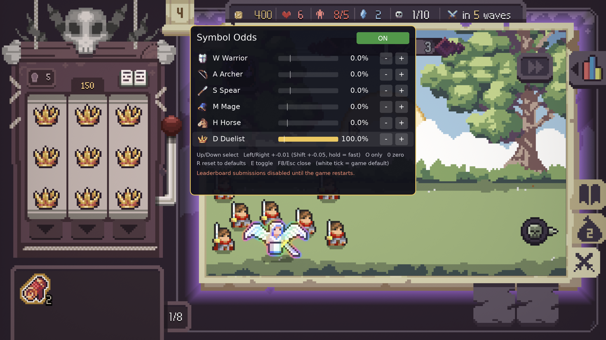

# Slotbound Tweaks

An unofficial, single-player tweak toolkit for [Slotbound](https://store.steampowered.com/app/4459590/Slotbound/) on macOS and Windows.
It adds an in-game panel (`F8`) for adjusting how the game plays, without modifying any game file.



> **Disclaimer.** This project is not affiliated with, endorsed by, or supported by Optima Arch, the developer of Slotbound.
> It is intended for personal, single-player use on a copy of the game you own.
> It does not contain, redistribute, or decrypt any game code or assets.
> Using it may break with game updates and is entirely at your own risk.
> Please don't report issues to the developer while it's active.
> If you are the developer and would like this project changed or taken down, please open an issue.

## Features

All features with settings live in one panel: press `F8` to open it, `Tab` to switch tabs.

| Feature | Where | Description |
|---|---|---|
| **Symbol Weights** | `F8` → Symbol Weights | Edit the slot machine's symbol weights (Warrior, Archer, Spearman, Mage, Cavalry, Duelist). Takes effect immediately and is saved between sessions. |
| **Unit Grades** | `F8` → Unit Grades | Edit the odds of each unit grade (Normal, Advanced, Rare, Legendary, Prism) for units spawned by winning lines. For example, always Prism. |
| **Items** | `F8` → Items | Choose or swap the current run's items: put any item into an item slot, change its level, delete it, or choose what the shop sells. |
| **Cores** | `F8` → Cores | Choose or swap the current run's cores: add any core, replace or remove one, or choose what the core selection screen offers. |
| **Imprints** | `F8` → Imprints | Change the imprints of the units on the board: add any imprint, replace or remove one, or change its level. |
| **Spin Log** | none | Optional per-spin diagnostics written to `logs/tweaks.log`. Off by default. |

Symbols, unit grades, items, cores and imprints, with their names, effects and icons, are all read from the game itself, so new content from a game update shows up without changing the tweaks.

More features are planned; see [Adding a feature](#adding-a-feature).

### Fair play: leaderboards

Slotbound has online leaderboards. Once any tweak changes gameplay during a session (for example, non-default symbol weights or unit grade odds, or an edited item, core or imprint), leaderboard submissions are **blocked until the game is restarted**.
To submit scores again, reset the tweaks to defaults (or turn them off) and restart the game.
Steam achievements are not affected.

Please keep it that way if you fork this project.

## Requirements

- Slotbound 1.0.3 from Steam
- **macOS:** Apple Silicon, and the Xcode Command Line Tools (for `lldb`): `xcode-select --install`
- **Windows:** 64-bit Windows 10 or later. Nothing to install: the launcher uses the built-in Windows PowerShell 5.1.
  Tested with Slotbound 1.0.4 (Steam) on Windows Server 2022, launched both from a terminal and through the Steam launch option.

## Install & launch

```sh
git clone https://github.com/chenyanchen/slotbound-tweaks.git
```

Steam must be running. Then pick one of these:

- **Terminal:** `./launch.sh`
- **Steam:** Library → Slotbound → Properties → Launch Options:
  ```
  "/absolute/path/to/slotbound-tweaks/launch.sh" %command%
  ```
  Then press Play as usual. To go back to the unmodified game, clear the launch option.

On first launch, macOS may ask to allow debugging (Developer Tools).
The launcher needs this permission to attach to the game.

### Windows

Same steps, with `launch.bat` instead of `launch.sh`:

- **Terminal:** `launch.bat` (finds the game through Steam's library folders), or `launch.bat "D:\path\to\Slotbound.exe"`
- **Steam:** Launch Options:
  ```
  "C:\absolute\path\to\slotbound-tweaks\launch.bat" %command%
  ```

  With a launch option set, Steam itself writes `steam_appid.txt` into the game folder. It is harmless and does not come from this project.

## The panel

| Key | Action |
|---|---|
| `F8` | Open / close the panel (`fn`+`F8` on Mac keyboards) |
| `Tab` / `Shift`+`Tab` | Next / previous tab (also clickable) |
| `Esc` | Close |

While the panel is open it takes all keyboard input; clicks outside it still reach the game.
The panel remembers the last tab you used.

### Symbol Weights tab

| Key | Action |
|---|---|
| `↑` / `↓` | Select a symbol (hold to repeat) |
| `←` / `→` | Weight −/+ 0.01, or 0.05 with `Shift`. Hold to repeat; holding for more than 1.5 s speeds up. The `-`/`+` buttons behave the same. |
| `O` | Only the selected symbol (100%) |
| `0` | Set the selected weight to 0 |
| `R` | Reset to the game's defaults |
| `E` | Toggle the feature on/off (off = game defaults) |

Percentages are weight ÷ total weight. The white tick on each bar marks the game's default probability.
The game's default weights are W 0.20, A 0.20, S 0.20, M 0.15, H 0.15, D 0.10.

Some cores (Mirage Goblet, Old Crown, Spore Shroom, Ban Stamp) temporarily bias the weights for a spin, and those effects still stack on top of your settings.
The Joker is not adjustable: its chance comes from cores and the game caps it at 5%.

### Unit Grades tab

Same keys and buttons as the Symbol Weights tab, for the five unit grades. To always get the top grade, select Prism and press `O`.

The white ticks show the game's current odds, which include your meta upgrades (without any: Normal 83%, Advanced 15%, Rare 2%, Legendary and Prism 0%).
While your odds differ from the game's, its rare/legendary pity (better odds after a long run of low-grade units) is switched off, so the percentages shown are exactly what is rolled. Turning the tab off or resetting restores the pity.

Only units spawned by winning lines are affected. Stone packs, cores (such as Joker Grin or Golden Lever) and promotions change grades their own way, as usual.

### Items tab

The left side lists the run's item slots (`Item slots`) and what the shop currently sells (`Shop`).
The right side is the catalog of every item, filterable by type. Hover anything to see its effect in the game's language.

1. Click a slot on the left: an item slot (filled or the first empty one) or a shop slot.
2. Click an item in the catalog to put it there.
   - **Item slot:** the item replaces what was there (or fills the empty slot) at level 1. Adjust the level with `-` / `+`, delete it with `x`.
   - **Shop slot:** the shop now sells that item; buy it as usual, with Essence.

| Key | Action |
|---|---|
| `↑` / `↓` | Select a slot |
| `←` / `→` | Level −/+ of the selected item |
| `Delete` / `Backspace` | Delete the selected item (no refund) |

In the catalog, a gold corner marks items you own and a green dot marks items in the shop.
Each item can be held once, and the number of item slots is the game's own (6 by default, more with upgrades).
Items can't be edited on the main menu or during a battle; changes apply from the next battle.
Some items are normally offered only on one stage ("stage N item"); you can place them anywhere, but their effect may assume that stage.

Edited items stay in the run's save. Continuing such a run after a restart blocks leaderboard submissions for that session too.

### Cores tab

Works like the Items tab. The left side lists the run's cores (`Cores`) and, while the game is offering cores, the three cards of the core selection screen. The catalog can be filtered by rarity.

- **Core slot:** the core replaces the one there (or fills the empty slot). New cores count as picked on the current wave, and appear at the end of the list. Remove one with `x` or `Delete`.
- **Core selection card:** the card now offers that core; pick it on the selection screen as usual.

Each core can be active once. Cores can't be edited on the main menu, during a battle, or while the slot machine is spinning.
Cores you add or offer are remembered in `config/cores.lua` while they are in the run, so continuing such a run after a restart also blocks leaderboard submissions.

### Imprints tab

Every unit the slot machine summons passes on an imprint when another unit absorbs it (it has no effect on the unit itself until then), and a unit can hold as many imprints as its grade allows (Normal 1, Advanced 2, Rare 3, Legendary 4, Prism 5).
This tab edits the imprints units already hold.

The left side lists the units on the board (`Units`, with how many imprint slots they use) and the imprints of the selected unit.
The right side is the catalog of every imprint, filterable by grade (the grade of the units that pass it on). Hover anything to see its effect in the game's language; hovering a unit also shows which imprint it passes on when absorbed.

1. Click a unit.
2. Click one of its imprint slots, then an imprint in the catalog to put it there.
   A replaced imprint keeps its level; a new one starts at level 1. Adjust the level with `-` / `+`, remove it with `x`.
   Clicking an imprint while the unit row itself is selected adds it to the unit's first empty slot.

| Key | Action |
|---|---|
| `↑` / `↓` | Select a unit or imprint slot |
| `←` / `→` | Level −/+ of the selected imprint |
| `Delete` / `Backspace` | Remove the selected imprint |

A gold corner in the catalog marks the selected unit's imprints. Each imprint can be held once per unit, as in the game, where absorbing a second copy levels it up instead.
The number of slots is the unit's own; the list always shows the most any unit can have (5), with the ones beyond the selected unit's grade marked `(locked)`. Imprints can't be edited on the main menu, during a battle, while the slot machine is spinning, or while the game's own imprint choice is open.

Edited imprints stay in the run's save. Continuing such a run after a restart blocks leaderboard submissions for that session too.

## Configuration

Each feature keeps its settings in `config/<feature>.lua`, which is created on first run. You can edit these files in-game or by hand.

```lua
-- config/spin_log.lua
return {
  enabled = true,
}
```

## How it works

Slotbound is a LÖVE 11.5 / LuaJIT game. Its code ships encrypted, and the launcher verifies its files, so this project never touches them.

1. `launch.sh` starts the game under `lldb` and sets a breakpoint on `luaL_loadbuffer`.
2. When the game's own bootstrap loads `@main.lua`, `inject.py` runs `loader.lua` in the game's Lua state.
   It then detaches, so the game runs without a debugger.
3. `loader.lua` sets up the hooks below and loads each module from `features/`:

   | Hook | Used for |
   |---|---|
   | `love.graphics.present` | Per-frame update and panel drawing |
   | `love.handlers` | Input |
   | `require` | Patching game modules as they load |

4. **Symbol Weights** rewrites `src.data.constants`' `slot.symbolWeights`, which the game reads on every roll.
   It also updates the base weights that cores restore after their one-spin effects.
5. **Items** edits the run's item slots (`ui._itemPurchased`) and the shop (`ui._itemOffers`).
   New inventory entries are built with the game's own `restorePurchasedItems`, the function that loads a saved run.
6. **Unit Grades** rewrites `src.data.constants`' `unitGrades.probabilities`, which the game reads on every unit spawn, and bypasses `src.game.luck`'s grade pity while active.
7. **Cores** adds and removes cores through the game's own `src.game.cores` `select` / `remove`, and edits the selection screen's offers (`ui._coreSelect.offers`).
8. **Imprints** edits each board unit's `imprints` list (`battlefield.rosterUnits`), building entries from `src.data.constants`' `imprint.definitions` with the game's own level helper, the one absorbing uses.

When launched from Steam, `launch.sh` takes two extra steps:

- It removes `DYLD_*` variables, because Steam's overlay injection crashes `lldb`. As a result, the Steam overlay is unavailable while using tweaks.
- It re-executes itself natively, because the Steam client runs under Rosetta. The game itself always runs natively (arm64).

On Windows, `launch.bat` starts `launch.ps1` in 64-bit PowerShell (Steam is a 32-bit process). `launch.ps1` compiles `inject.cs` on the fly; it plays the role of `lldb` + `inject.py`.
It starts the game as a debuggee, sets a breakpoint on `luaL_loadbuffer` in `lua51.dll`, and when `@main.lua` is loaded, runs a few generated instructions on the game's thread that call `luaL_loadfile` + `lua_pcall` on `loader.lua`. It then restores the thread and detaches.

## Adding a feature

1. Create `features/<name>.lua`:

   ```lua
   return function(T)
     local cfg = T.config.load("<name>", { enabled = true }) -- config/<name>.lua
     local F = {}
     function F.update(dt) end
     function F.draw() end                          -- after the game has drawn (and the panel)
     function F.keypressed(key) return false end    -- return true to swallow
     function F.mousepressed(x, y, button) return false end
     function F.mousereleased(x, y, button) return false end
     function F.onRequire(name, module) end         -- a game module was loaded
     return F
   end
   ```

2. Add `"<name>"` to `FEATURES` at the top of `loader.lua`.
3. If the feature changes gameplay, call `T.taint("<reason>")` while it's active.
4. For settings UI, add a tab to the `F8` panel instead of handling a hotkey yourself:

   ```lua
   T.panel.addTab({
     id = "<name>", title = "My Feature",
     draw = function(x, y, w, h, s) end,       -- content rect in pixels, s = UI scale
     keypressed = function(key) end,           -- only while this tab is showing
     mousepressed = function(x, y, button) end -- only for clicks inside the content rect
   })
   ```

   `T.panel.isShowing("<name>")` tells whether your tab is visible; `T.panel.button(rect, label, font, active, enabled)` draws a button.
   For a bar editor like Symbol Weights or Unit Grades, use `T.weights.tab(spec)` (see `weights.lua`); for a "slots + catalog" tab like Items, Cores or Imprints, use `T.picker.tab(spec)` (see `picker.lua`).

Other helpers:

- `T.log(fmt, ...)` writes to the log.
- `T.font(px)` returns a cached font.
- `T.config.save(name, tbl)` saves a config file.
- `T.loadLua(relpath)` loads a Lua file. Use it instead of `loadfile`, which the game's bootstrap restricts to its own package.

If a feature throws an error, it is disabled and the error is logged. The game keeps running.

## Troubleshooting

Logs are in `logs/`:

| File | Contents |
|---|---|
| `launch.log` | Launcher |
| `inject.log` | Injection |
| `tweaks.log` | Features |
| `game.log` | Game stdout |

- If injection fails, the game still starts, just without tweaks. Check `inject.log`.
- `SB_DRYRUN=1 ./launch.sh` checks `lldb` and `python3` without starting the game.
  On Windows, `set SB_DRYRUN=1` then `launch.bat` checks PowerShell, compiles `inject.cs`, and logs where it found the game.
- `SB_SELFTEST=1 ./launch.sh` (Windows: `set SB_SELFTEST=1` then `launch.bat`) runs a self-test:
  - samples the game's real symbol picker 200,000 times and logs the distribution;
  - opens the panel through a synthetic `F8` key event;
  - saves a screenshot of each tab as `logs/selftest-<tab>.png`.
- Game updates can change internals. The code was written against Slotbound 1.0.3.

## License

[MIT](LICENSE) © Yanchen Chen. Covers this project's own code only. Slotbound is © Optima Arch.
